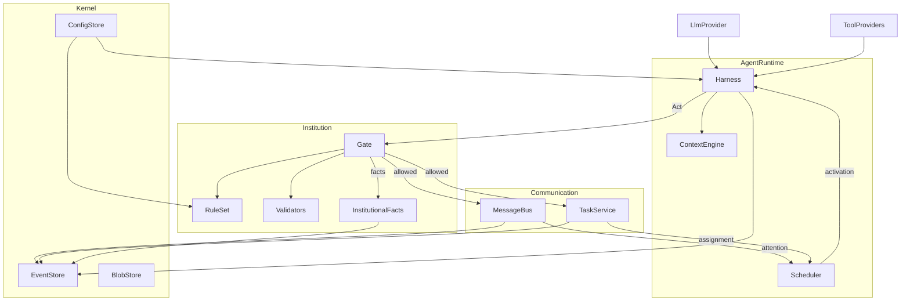

# 00 · 总体设计

> 状态：v0.1（2026-09-23）。本文件规定 SciTeam 的工作原理与分层；每个模块的接口、数据结构与测试见 `10`–`70` 详细设计。需求与证据的对应关系见 `90`，里程碑见 `91`。

## 1. 目标

SciTeam 是一个可以真实使用、同时作为系列论文实验平台的多智能体系统。它要回答两个问题：

1. 工程上：用户能否从一个创始人 agent 出发，确立组织使命，搭建组织，雇佣 agent，完成真实的研究与工程任务？
2. 科学上：在同一个冻结的解释器下，只改变配置文件（harness、通信策略、制度规则、组织结构），系统行为与结果如何变化？

## 2. 建造顺序（硬约束）

五层自下而上，每层都要先通过真实模型验收，才开始写上一层：

1. **单 agent harness**：单个 agent 在公开基准上达到优秀成绩（SWE-bench Verified 全量、Terminal-Bench 2.x）。
2. **通信**：私聊、房间、mention、线程、任务，以及事件驱动的调度器。
3. **制度**：行为（Act）、闸门（Gate）、算数规则、验证器、账本、修宪。
4. **组织**：创世宪法、创始人、组织章程生效、雇佣、目标与停机。
5. **演化与实验**：受权修改配置文件；实验规格、外部评测、指标提取。

不写空框架，不写「以后再接」的桩。一个模块只有在被上层真实使用、并有测试覆盖时才存在。

## 3. 预算原则

成本不是约束。预算、步数、墙钟上限只作防失控的断路器，量级要让正常任务永远碰不到。真实测试里，凡是因断路器结束的任务，一律按 harness 缺陷排查，不计为模型能力的结果。推理强度用模型支持的最高档。

## 4. 工作原理

一句话：**所有东西都是事件；状态是事件的折叠；agent 是由事件唤醒的 actor；agent 对外产生效力的每个动作都是一次行为（Act），经同一个闸门（Gate）裁决后才生效。**

一次完整循环：

1. 某个 agent 的收件箱出现注意项：被 mention、收到私聊、被指派任务、所负责目标的状态变化。调度器为它开一次**激活**。同一 agent 的激活串行执行，不同 agent 的激活并发执行，受全局并发上限约束。
2. 激活内运行单 agent harness。上下文引擎组装提示，模型调用工具，最后必须以 `finish` 结束，并给出类型化结局。
3. 工具分两类。纯读工具（读文件、检索文献、读会话）直接执行。对外产生效力的工具（发消息、派任务、提交产物、评审裁决、提修正案、雇人）先构造 Act，交给 Gate。
4. Gate 按当前规则版本裁决：允许、拒绝，或进入审批。允许的 Act 产生领域事件，例如消息送达、任务状态变化；满足算数规则的 Act 另产生制度事实，例如「假设集已被接受」。被拒绝的 Act 同样入账，并以工具错误的形式返回给 agent。
5. 新事件唤醒其他 agent。系统静止，或目标的停机谓词成立时，调度器通知目标责任席位或人类。

第一层只有其中的 kernel、providers、harness：激活由命令行或基准驱动触发，Gate 接口在 harness 里预留为一个可注入的钩子，默认全部允许。

## 5. 分层与包结构

| 包 | 职责 | 详细设计 | 所属层 |
|---|---|---|---|
| `sciteam/kernel/` | EventStore、BlobStore、ConfigStore、ID、时钟 | `10-kernel.md` | 1 |
| `sciteam/providers/` | LLM、沙箱、文献的 Protocol 与适配 | `11-providers.md` | 1 |
| `sciteam/harness/` | 单 agent 循环、上下文、压缩、预算、工具、终止、恢复、技能、记忆 | `20-harness.md` | 1 |
| `sciteam/comm/` | 地址、会话、消息、收件箱、任务、通信工具 | `30-communication.md` | 2 |
| `sciteam/runtime/` | 调度器、激活、静止检测 | `31-runtime.md` | 2 |
| `sciteam/institution/` | Act、Gate、规则、算数、验证器、程序、修宪、事实折叠 | `40-institution.md` | 3 |
| `sciteam/org/` | 创世、组织 manifest、席位、雇佣、目标 | `50-organization.md` | 4 |
| `sciteam/experiment/` | 实验规格、覆盖层、外部评测、指标 | `60-experiment.md` | 5 |
| `sciteam_web/` | BFF 与前端（独立包，内核不依赖它） | `70-web.md` | 2 起 |
| `bench/` | 基准驱动：SWE-bench、Terminal-Bench | `20-harness.md` §12 | 1 |
| `configs/` | harness 配置、模型目录、通信策略、制度规则、agent 档案、组织 manifest | 各层 | 1 起 |

依赖方向：`kernel` ← `providers` ← `harness` ← `comm`/`runtime` ← `institution` ← `org` ← `experiment`；`sciteam_web` 只读事件库并调用运行时 API。任何下层模块不得 import 上层模块。

## 6. 配置与可演化性

- 所有可演化的东西都是 `configs/` 下的文件：harness 配置、提示词、技能、通信策略、制度规则、组织 manifest、agent 档案。
- 运行时只读取配置。第三层起，配置的唯一修改途径是修宪 Act，由有权限的席位发起、按程序审议后生效，生效后产生新的规则版本。
- 每次运行开始时，把用到的全部配置文件的内容摘要和解释器版本写入 `run_started` 事件。论文中的「自变量」就是这些摘要的差异。
- 默认值只在配置文件里出现一次。代码里不散落常数；没有配置的必填项在加载时报错。

## 7. 可观测性

事件库是唯一真相源，所有视图都由它折叠得到：

- agent 的每次激活：每轮提示的组成、模型输出与推理、工具调用与结果、压缩、预算；
- 通信：房间、私聊、任务及其线程；
- 制度：Act 裁决流、制度事实、规则版本、待审批项。

第一层提供命令行查看器（`sciteam trace <run>`）；第二层起提供 Web 界面，并通过 WebSocket 实时推送。

## 8. 论文中的「完备性」

不主张原语完备，也不主张覆盖所有已发表的协作协议。主张的是**对本系统声明的需求矩阵完备**：矩阵的每一项都有机制、单元测试和真实运行证据。矩阵见 `90-requirements-matrix.md`，分四组：

- H：harness（终止协议、预算可见、压缩与取回、输出截断与取回、错误恢复、崩溃恢复、并发工具、循环检测……）；
- C：通信（私聊、房间、mention 唤醒、线程、任务状态机、认领、策略裁决、速率与静止检测……）；
- I：制度生命周期（规格 → 校验 → 执行 → 观测 → 修订 → 回归）；
- O：组织（创世、章程生效、雇佣与缺岗、目标与停机）。

另外展示表达力：在同一内核上，只用配置文件表达层级、扁平、工作流、wave、认领市场五种协作模式，各有一次真实运行。

## 9. 与旧系统的关系

- 旧 `paper/lab/_oss_export` 冻结，只用于复现 arXiv v1 已有证据。
- 新系统不继承旧代码。旧系统的思想和组件只在需要时移植，每次移植在对应详细设计里注明来源和评审结论。
- 外部项目的算法移植（pi、Hermes）同样逐项注明出处与许可证（两者均为 MIT）。

## 10. 不做

- 内核里不写任何部门、角色或拓扑枚举；它们全部是配置。
- LLM 不直接判定算数。
- 首版不做 swarm、多租户、分布式部署。
- 第一层验收通过之前，不写通信代码。

## 术语

| 术语 | 含义 |
|---|---|
| 事件（Event） | EventStore 中不可变的一条记录，属于某个流（stream），带哈希链 |
| 激活（Activation） | 调度器为某 agent 开启的一次 harness 运行，以类型化结局结束 |
| 结局（Outcome） | 激活的结束类型：`completed`、`blocked`、`need_input`、`handoff`、`budget_exhausted`、`error` |
| 行为（Act） | agent 对外产生效力的动作，需经 Gate 裁决 |
| 闸门（Gate） | 唯一执法点，按规则版本对 Act 给出允许、拒绝或待审批 |
| 制度事实（Fact） | 按算数规则成立的结论，例如「任务 T 的产物已被接受」 |
| 席位（Seat） | 制度中的职位，带权限；agent 占据席位后才能以该席位行事 |
| 规则版本 | 制度配置的一个内容摘要；每条 Act 按其生效时的规则版本裁决 |
| 断路器 | 防失控的上限；触发即视为缺陷，不是正常的停止条件 |
