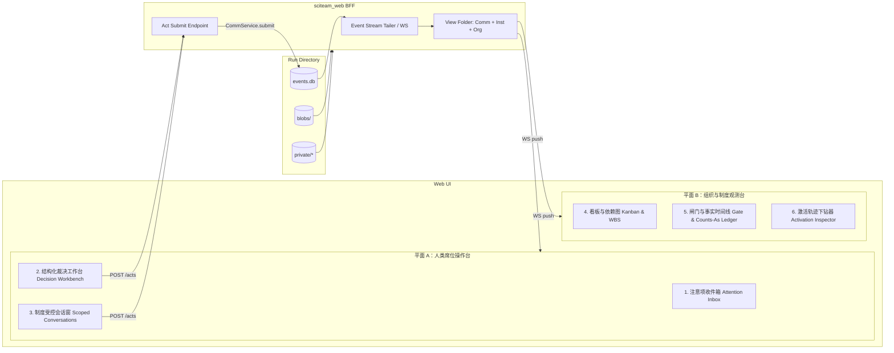

# 70 · Web 观测与人类席位操作台（`sciteam_web`）

> 所属层：独立外围包（`00` §5：`sciteam_web/` 只读事件库并调用运行时/通信 API，内核不依赖它）。
> 依赖：`kernel`、`comm`、`runtime`、`institution`、`org`。服务于第二层移入的 Web 聊天视图与第五层 `X-human`（`60` §14）真人席位交互。
> 状态：v0.1（2026-10-19 设计稿）。

## 1. 核心设计原则：人不是系统外的「超级管理员」，而是制度内的「席位」

多智能体系统常见的 UI 误区是把界面做成「上帝视角调试器 + 一键 Approve 按钮」：人类要么面对几万行滚动日志与几百行原始代码无从下手（认知过载），要么在缺乏冲突证据的情况下顺手点通过（沦为橡皮图章，Automation Bias）。

`sciteam_web` 的设计完全由 SciTeam 的底层制度语义驱动，遵循五条铁律：

1. **单一真相源（Everything is a Fold of `events.db`）**：Web 后端不设独立的业务数据库。组织名册、会话线程、任务看板、制度账本、规则版本、注意力收件箱全部由 `runs/<run>/events.db` 的事件流实时折叠生成。
2. **人类操作即标准制度行为（Human Action = Institutional `Act`）**：人类在 UI 上的每一次点击（批准/驳回待决项、评审通过/退回/取消任务、发送私聊或房间消息、批准修正案）都构造标准 `Act(actor=<human_id>, kind=...)`，经同一个 `CommService.submit` 与 `InstitutionGate` 裁决并落盘。**不存在绕过 Gate 直接改状态的后台后门**；因此含人运行的 `check.py` 确定性重放审计（`replay_ok`）100% 成立。
3. **注意力路由优先于全量日志（Attention-First, Evidence-on-Demand）**：人类默认看到的不是全部智能体的内部思考流，而是由 `attention_for(ev, view, policy)` 精确推导出的**「该人类席位的待办收件箱」**。只有当制度规则（如双盲比对失败升级、章程签字、任务评审）产生针对该人类席位的注意项时，才向人类索取决策。
4. **冲突卡片化以对抗橡皮图章（Structured Dispute Card over Raw Code Dump）**：当人类被请求裁决时，UI 置顶展示**「为什么唤醒你（命中哪条制度规则）+ 结构化证据对比（如 `agree.py` 失败的步骤、双方在该步的公式/约定摘要与输出差异）」**，原始代码与完整激活轨迹作为按需展开的下钻层（Progressive Disclosure）。
5. **客观测量人类注意力成本（Built-in Attention Telemetry）**：服务于 `X-human`（`60` §14）实验，前端在提交人类 `Act` 时自动在 `act.params._ui_telemetry`（或伴随事件）中记录卡片打开时间戳、展开查看过的证据面板与决策耗时，使 `human_attention_s` 与 `attention_leverage` 可由事件流精确重算。

---

## 2. 界面双平面架构（Dual-Plane UI）

`sciteam_web` 分为两个正交平面：**「我的席位操作台（Human Seat Workstation）」**（面向组织内扮演 `@pi` / `@owner` / `@reviewer` 的人类参与者）与 **「组织与制度观测台（Institutional Observatory）」**（面向实验者与审计者）。

---

## 3. 平面 A：人类席位操作台（Human Seat Workstation）

当用户以某个 `kind: human` 的成员身份（如 `@pi` 或 `@owner`）进入一个运行（或跨运行的实验队列）时，界面采用**左收件箱 · 中裁决台 · 右上下文与对话**的三栏布局：

### 3.1 左栏：制度注意项收件箱（Attention Inbox）

直接绑定 `runtime/attention.py` 中 `agent == human_id` 且未处理的注意项，按制度紧迫度分三组：

1. **待签字审批（`approval_requested`，阻塞 Gate）**：
   - 如组织章程生效（`human_ratify`）、目标发布签字（`release-signoff`）、或双盲分歧升级裁决（`dispute-escalation`）。此时对应 `Act` 处于 `pending` 状态，调度器正在 `on_quiescent: "wait"` 等待人类拍板。
2. **待我评审或处理的任务（`task_review` / `task_assigned`）**：
   - 人类作为 `task.reviewer`（如 `X-human` 中的 `@pi` 评审分歧汇总任务）且任务已进入 `in_review`。
3. **提及与私聊提问（`mention` / `dm`）**：
   - 如 `human-spec-clarify` 臂中，`@auditor` 在开工前向 `@pi` 发起的规格约定澄清提问，或下属成员触发 `faulted` / 遇到环境缺口时的上报。

> **实验盲测模式（Blind Experiment Mode，用于 `X-human` Track B）**：当从实验队列进入时，左栏只显示匿名任务代号（如 `Case #07`），自动隐藏臂名（`human-signoff` vs `human-on-dispute`）、重复号和外部判分器分数，并在右上角显示倒计时（如 `90s`），确保真人实验无主观偏见。

### 3.2 中栏：结构化裁决工作台（Structured Decision Workbench）

选中一条注意项后，中栏不是裸聊天框，而是根据触发该注意项的制度上下文自动渲染**四段式《制度裁决卡（Institutional Decision Card）》**：

| 区块 | 展示内容 | 解决什么人类认知痛点 |
|---|---|---|
| **① 制度触发头（Rule & Authority Header）** | 显示当前待决动作（例：`@auditor 请求批准任务 T1 [goal]`）、命中的制度规则（例：`rule: agree-or-escalate`）、当前规则版本哈希（`rule_version`）以及你的裁决会产生什么制度事实（例：`通过 → 产生 fact: accepted 并停机；退回 → 重新唤醒指定实现者`） | 让人类清楚知道**自己在行使哪项制度权力、签字后有什么法律/制度后果** |
| **② 机械验证与分歧证据摘要（Mechanical Evidence & Diff Summary）** | 自动解析最近一次 `validation_finished` 的结构化输出与 `@auditor` 的评审摘要： • **在 `human-on-dispute` 下**：高亮表格列出 `agree.py` 通过了哪几步（如 `74.2, 74.3` 绿勾）、**在哪一步发生分歧（如 `step 74.1` 红叉）**，并并排展示 `@auditor` 提取出的 `impl1` 与 `impl2` 在该步的公式约定差异及测试输入下的数值对比（如 `impl1 = 0.4122` vs `impl2 = 0.8244`，相差 $2\times$）。 • **在 `human-signoff` 下**：展示提交者的完工摘要与 `present` / 自测结果（如实反映无双盲比对时人类所能看到的信息面）。 • **在修宪审批（`human_ratify`）下**：渲染 YAML 规则集修改前后的 unified diff 及受保护规则（`protected_rules`）检查结果 | **将「大海捞针找 bug」转化为「针对明确分歧点做领域判断」**，把人类的每次审阅时间控制在 30–90 秒内 |
| **③ 按需下钻抽屉（On-Demand Evidence Drawer，默认折叠）** | 提供标签页按需展开：(a) 题目原始规格说明（`problem_description`）；(b) `/private/impl1/solution.py` 与 `/private/impl2/solution.py` 在分歧函数处的并排代码 diff（仅当当前通信/挂载策略允许该人类角色读取时可见）；(c) 验证沙箱原始 `stdout/stderr` blob | 既保持首屏极简（≤ 600 tokens 阅读量），又允许深度核查；每一次展开点击都被遥测记录 |
| **④ 制度动作栏（Typed Institutional Actions）** | 根据当前对象的合法状态机迁移渲染操作按钮与必填理由框（`note`）： • **针对 `approval_requested`**：`[批准生效 (Approve)]` / `[驳回 (Reject - 必填理由)]` • **针对双盲分歧裁决（`human-on-dispute`）**：`[裁定 Impl1 约定正确 → 退回 Impl2]` / `[裁定 Impl2 约定正确 → 退回 Impl1]` / `[双方约定均错 → 给出正确物理约定并退回双方]` / `[目标不可行 → 取消目标 (Cancel Goal)]` • **针对规格澄清（`human-spec-clarify`）**：快捷回复框（直接调用 `post_message` 回复 `@auditor` 并解除等待） | 杜绝自由文本指令歧义，确保人类的判断直接落地为受 Gate 约束的确定性状态迁移 |

### 3.3 右栏：受通信策略约束的会话窗（Policy-Scoped Conversations）

- 实时展示当前任务会话（`task:T1`）、与汇报人的私聊（`dm:auditor+pi`）或公共房间（`#general`）。
- 支持 `@mention` 自动补全，但补全列表严格过滤为**当前 `comm/*.yaml` 允许该人类席位联系的成员**（在 UI 层直观体现「通信即制度」）。
- 人类在会话中发出的消息同样经过 `CommService.submit` 写入 `conv/*` 流，并产生注意项唤醒被 `@` 的智能体。

---

## 4. 平面 B：组织与制度观测台（Institutional Observatory）

面向研究者与系统管理员，提供对单次运行（`runs/<run>`）或整场实验（`runs/exp/<exp>`）的全景透视，包含四个视图：

1. **组织拓扑与席位状态图（Org Roster & Live Status）**：
   - 读取 `roster` 流与 `org_enacted` 事件，展示当前生效的组织架构（谁向谁汇报、各席位属于哪个 `group:`、工作区挂载权限是 `rw` 还是 `ro`、谁能读谁的 `/private/<id>`）。
   - 实时反映每个成员的调度状态（`idle` / `running` / `faulted`）、已用激活次数与累计花费 `cost_usd`。
2. **WBS 任务看板与依赖图（Kanban & Dependency DAG）**：
   - 按 `open → assigned → in_progress → in_review → done / cancelled / blocked` 展示全部任务卡，连线标注 `FS/SS/FF/SF` 依赖与关键路径（CPM）。
   - 任务卡上直接打标当前已获得的**制度事实徽章（Institutional Fact Badges，如 `✓ validated:agree`、`✓ fact:accepted`）**。
3. **闸门裁决与账本时间线（Gate & Counts-As Timeline）**：
   - 这是 SciTeam 区别于普通 Agent 框架的核心视图：按全局 `seq` 展示每一条 `act_submitted → act_decided (allow / deny / pending) → validation_finished / approval_decided → act_resolved → fact_established / ledger_entry` 的因果链（`causation_id` 高亮追踪）。
   - 支持一键过滤**「被制度拒绝的越权动作（`decision == deny`）」**（如实现者试图私聊同伴、未签发环境证书就尝试 `start`）以及**「规则版本切换点（`rule_version_activated`）」**。
4. **单次激活内部轨迹检查器（Activation Trace Inspector）**：
   - 点击任意成员的某次激活（`act_<ulid>`），下钻查看该次激活的完整简报（Briefing 7 段结构）、每轮模型推理（`reasoning_content`）、工具调用与截断恢复、上下文压缩事件（`compaction_finished`）及 token 账单。

---

## 5. 传输契约与后端接口（BFF Contract）

`sciteam_web` 采用极薄的 FastAPI + WebSocket 实现（静态前端采用单页应用或零构建成本的现代模块化前端），所有写接口统一收口于 `POST /api/runs/{run_id}/acts`：

| 方法与路径 | 用途 | 核心逻辑 |
|---|---|---|
| `GET /api/runs` | 列出运行或实验队列 | 扫描指定根目录下的 `events.db` 与 `result.json` / `paused.json` |
| `GET /api/runs/{id}/state` | 获取折叠后的当前全量视图 | 返回 `CommView`（名册、会话、任务）、`InstitutionView`（规则版本、待决项、事实、账本）、`Attention`（按成员分组的未处理注意项） |
| `WS /api/runs/{id}/stream` | 实时尾随事件流与增量状态 | 监听 `events.db` 新增 `seq > cursor` 的事件，推送 `{event, view_delta, human_inbox}` |
| `GET /api/runs/{id}/dispute-card/{task_id}` | 组装结构化《制度裁决卡》 | 提取目标任务的最新 `validation_finished` 输出（如 `agree.py` 的步骤分歧 JSON）、`@auditor` 评审消息与 `/private/*` 对应函数片段 |
| `POST /api/runs/{id}/acts` | **唯一写入口**：提交人类 `Act` | 请求体 `{actor, kind, params, telemetry}` → 调用 `CommService.submit`（及 `InstitutionService.settle`）→ 若运行处于 `on_quiescent: "wait"`，唤醒后台调度器继续推进 |
| `GET /api/runs/{id}/blobs/{sha}` | 读取验证输出或大附件 | 从 `BlobStore` 读取原文 |

---

## 6. 验收标准（W1–W4）

| 编号 | 验收项 | 判据 |
|---|---|---|
| **W1** | 只读折叠一致性 | Web 端展示的任务状态、制度事实、账本余额、待决审批与 `check.py` 离线折叠结果 100% 逐字段一致 |
| **W2** | 人类动作入账与可重放 | 通过 Web 界面完成一次创世章程批准（`decide_pending`）、一次双盲分歧裁决退回（`task_transition: reject` + 定向消息）与一次最终批准；运行结束后 `bench/team/check.py` 重放审计 `replay_ok == True`，0 无因果事件 |
| **W3** | 唤醒恢复闭环 | 当运行配置为 `on_quiescent: "wait"` 时，智能体提交触发 `approval_requested` 后调度器自动挂起等待；人类在 Web 界面点击裁决后，调度器在 2 秒内自动唤醒对应智能体继续执行直至 `goal_met` |
| **W4** | `X-human` 盲测与注意力遥测 | 支持盲测队列模式，人类完成裁决后事件库内完整记录 `human_attention_s` 与展开面板轨迹，分析脚本可直接据此算出 `attention_leverage` 与 `rubber_stamp_rate` |
